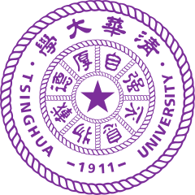
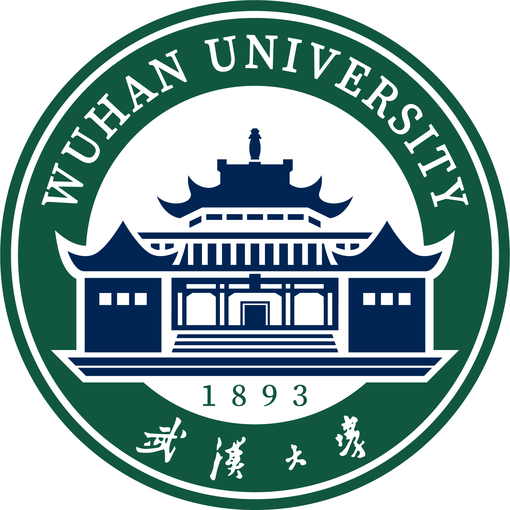

## About Me 👋

I earned my master’s degree in Artificial Intelligence from [Tsinghua University](https://www.tsinghua.edu.cn/en/) , advised by [Prof. Haoqian Wang](https://www.sigs.tsinghua.edu.cn/whq_en/main.htm), and my bachelor’s degree in Navigation Engineering from [Wuhan University](https://en.whu.edu.cn/) . I am currently a **Researcher in the GWM (Generative World Model) team** at , focusing on **3D vision, generative models, and world models**. Previously, I interned at **Huawei Noah’s Ark Lab**, focusing on **sparse-view 3D reconstruction**.

🤝 I welcome collaborations, and you can reach me at [chenkangjie123@gmail.com](mailto:chenkangjie123@gmail.com).
